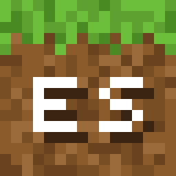
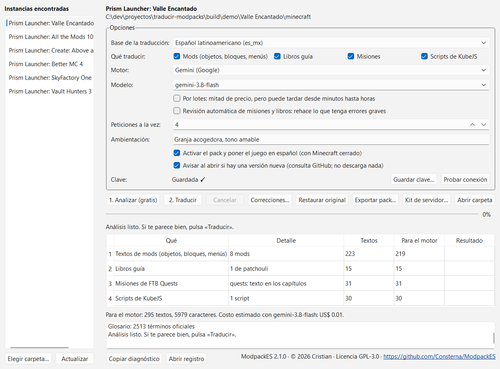

<div align="center">



# ModpackES

**Traduce modpacks de Minecraft al español:** misiones, libros guía, scripts de KubeJS y los textos de
todos los mods, con un par de clics.

[](https://github.com/Consterna/ModpackES/actions/workflows/ci.yml)
[](https://github.com/Consterna/ModpackES/releases/latest)
[](LICENSE)


[**Descargar ModpackES.exe**](https://github.com/Consterna/ModpackES/releases/latest/download/ModpackES.exe)
· [Cómo se usa](#cómo-se-usa) · [Preguntas frecuentes](#preguntas-frecuentes) · [Cambios](CHANGELOG.md)



</div>

## Qué hace

ModpackES lee tu modpack, encuentra todo lo que sigue en inglés y lo traduce con la API de Gemini de Google.
Funciona con **cualquier versión** (de 1.7.10 a 26.x), **cualquier loader** (Forge, NeoForge, Fabric, Quilt)
y **cualquier lanzador**, y escribe a la vez las siete variantes de español del juego.

- **No modifica los jars de los mods.** Lo de los mods va en un resource pack aparte.
- **Todo tiene copia de seguridad.** Un botón devuelve el modpack a su texto original.
- **No se paga dos veces.** Lo ya traducido queda en una memoria que se reutiliza, también entre modpacks.
- **Respeta los formatos.** Colores, enlaces, variables y comandos llegan intactos; lo que no pasa las
  reglas de calidad se reintenta o queda en inglés antes que romper algo.

| Contenido | Formatos | Dónde queda |
|---|---|---|
| Textos de mods (objetos, bloques, menús, tooltips) | `lang/*.json` (1.13+) y `.lang` (1.12 y antes), incluidos los jars anidados, KubeJS y los resource packs del modpack | Resource pack `Traduccion_ES` |
| Misiones | FTB Quests (texto en los capítulos, carpeta `lang/` de 1.21+ y NBT de 1.12), BetterQuesting, HQM, Heracles | En su sitio, con copia de seguridad |
| Libros guía | Patchouli, Mantle (Tinkers), Citadel (Alex's Mobs), GuideME (AE2), Lavender. Modonomicon va por claves de idioma | Resource pack (o en su sitio, si es un libro propio del modpack) |
| Scripts de KubeJS | Lo que ve el jugador: `tell`, `displayName`, `Text.of`, tooltips, información de JEI/REI/EMI | En su sitio, con copia de seguridad |

Lo que el mod ya trae en español no se toca, y si existe una variante (por ejemplo `es_es`) se copia a las
demás sin gastar. Los libros antiguos de Patchouli que guardan el texto dentro del jar no se pueden traducir
sin modificar el mod: la app avisa cuáles son.

## Cómo se usa

1. Descarga [`ModpackES.exe`](https://github.com/Consterna/ModpackES/releases/latest/download/ModpackES.exe).
   No necesita instalación.
2. Cierra Minecraft y abre `ModpackES.exe`.
3. Elige la instancia de la lista. Salen las de Prism Launcher, MultiMC, CurseForge, Modrinth, ATLauncher,
   GDLauncher y el launcher oficial; si no aparece, usa «Elegir carpeta…».
4. Pulsa «Guardar clave…» y pega tu clave de [aistudio.google.com/apikey](https://aistudio.google.com/apikey).
   Se guarda en el Administrador de credenciales de Windows, nunca en un archivo.
5. Pulsa **1. Analizar (gratis)**: cuenta lo que falta y estima el costo.
6. Pulsa **2. Traducir**. Al terminar activa el pack y pone el juego en español (se puede desmarcar).

Si se corta o lo cancelas, vuelve a pulsar «Traducir»: sigue donde quedó.

El campo **Ambientación** (opcional) le cuenta al motor de qué va el modpack: «granja acogedora, tono
amable; “Bells” es la moneda del pueblo». Ayuda con el tono y con los términos propios del pack, y se guarda
por instancia.

**Restaurar original** devuelve misiones, scripts y libros propios al texto del modpack. Para quitar la
traducción de los mods basta con desactivar el resource pack.

**Correcciones…** busca cualquier texto en la memoria (en inglés o en español) y te deja corregir su
traducción a mano. La corrección manda sobre todo lo demás, vale para todas las misiones, libros y mods
donde aparezca ese texto y se aplica la próxima vez que pulses «Traducir», sin costo. Si a la corrección le
falta un código del original (`%s`, `§a`, `$(l)`…), no se guarda, para que no rompa el juego.

> [!NOTE]
> El ejecutable no tiene firma digital, así que la primera vez Windows SmartScreen puede avisar. Pulsa
> «Más información» → «Ejecutar de todas formas». Puedes comprobar el archivo con el SHA-256 que viene en la
> página de cada versión.

## Costo

Con `gemini-3.8-flash` un modpack grande (unos 800 000 caracteres por traducir) cuesta alrededor de
**1,5 a 2 dólares**, y la mitad con la opción «Por lotes» (Batch API), que puede tardar desde minutos hasta
horas. Un modpack pequeño cuesta centavos. Son estimaciones con los precios de Google de noviembre de 2026;
el botón «Analizar» calcula el de tu modpack antes de gastar nada.

La capa gratuita de Gemini sirve para probar, pero tiene límites de peticiones por minuto y por día que un
modpack grande supera enseguida. Con la facturación activada (nivel 1) se traduce de una vez.

## Multijugador

Las misiones y los scripts de servidor los lee el servidor. «Kit de servidor…» arma un `.zip` con esos
archivos ya traducidos, el resource pack para los jugadores y las instrucciones. «Exportar pack…» saca solo
el resource pack, para compartirlo con quien juegue el mismo modpack.

## Preguntas frecuentes

<details>
<summary><b>¿Puede romper mi modpack?</b></summary>

Cada archivo que se cambia se guarda antes en `traductor_es/respaldo` dentro de la instancia, y «Restaurar
original» los devuelve. Los archivos se reescriben sin pérdidas (solo cambian los textos traducidos) y las
pruebas validan el resultado con los parsers reales del juego (Gson y el SNBT de FTB Library).
</details>

<details>
<summary><b>¿Qué pasa cuando el modpack se actualiza?</b></summary>

Vuelve a pulsar «Traducir». Lo que ya estaba traducido sale de la memoria sin costo y solo se paga lo nuevo.
</details>

<details>
<summary><b>¿Qué se envía a Google?</b></summary>

Solo los textos que hay que traducir, con los códigos cambiados por marcadores y la clave del mod como
contexto. No se envía
nada más del PC. Ten en cuenta que, según las condiciones de Google, los datos de la capa gratuita pueden
usarse para mejorar sus productos.
</details>

<details>
<summary><b>¿Por qué un texto quedó en inglés?</b></summary>

Porque la traducción no pasó las reglas de calidad (perdía un código, cambiaba el sentido de un comando o
seguía en inglés) después de los reintentos. Es preferible a meter un texto que rompa el juego. Puedes volver
a traducir más tarde: solo se reintenta lo pendiente.
</details>

<details>
<summary><b>¿Funciona en Linux o macOS?</b></summary>

El `.exe` es para Windows. El código es Python y casi todo es multiplataforma, pero la detección de
lanzadores y el guardado de la clave solo se probaron en Windows.
</details>

## Línea de comandos

Desde el código fuente (ver [Desarrollo](#desarrollo)):

```
uv run modpackes instancias
uv run modpackes analizar "RUTA DE LA INSTANCIA"
uv run modpackes traducir "RUTA" [--dialecto es_es] [--solo misiones,libros] [--lotes] [--modelo gemini-3.5-flash-lite] [--contexto "granja acogedora"]
uv run modpackes restaurar "RUTA"
uv run modpackes clave guardar
uv run modpackes modelos
```

`traducir --simular` hace una prueba completa sin la API (antepone «ES» a cada texto); úsalo en una copia.

## Cómo protege el modpack

- Los códigos de formato (`%s`, `§a`, `&c`, `$(l)`, `{image:…}`, `${…}`, comandos, ids, enlaces) se cambian
  por marcadores antes de enviar el texto. Una traducción que pierde o inventa un marcador se descarta.
- Cada traducción pasa reglas de calidad: no puede estar vacía, seguir en inglés, tener un largo raro o meter
  saltos de línea nuevos. Lo que no pasa se reintenta y, si sigue mal, queda en inglés.
- Los archivos se reescriben sin pérdidas: solo cambian los textos traducidos y todo lo demás queda byte a byte
  igual.
- Un glosario con los nombres oficiales de Minecraft y de los mods mantiene los mismos términos en misiones,
  libros y scripts.

## Desarrollo

Requisitos: [uv](https://docs.astral.sh/uv/) (instala Python 3.13 solo) y, para las pruebas con los parsers
del juego, un JDK 17 o superior (sirve el de Prism Launcher).

```
uv sync
uv run python scripts/verificar.py            # ruff, pyright estricto, compileall y pytest con cobertura
uv run python scripts/verificar.py --rapido   # sin las pruebas de Java ni el corpus real
uv run python scripts/construir_exe.py        # dist/ModpackES.exe
uv run python scripts/probar_exe.py           # arranca el .exe y analiza un modpack de prueba
```

Los datos de la app (memoria, glosario, preferencias y `registro.log`) van a `%LOCALAPPDATA%\traductor-es`;
la variable `TRADUCTOR_ES_DATOS` los lleva a otra carpeta. Las pruebas con Java buscan Gson en las bibliotecas
de Prism Launcher o usan el jar que indique `TRADUCTOR_ES_GSON` (así corren en el CI). Lee
[CONTRIBUTING.md](CONTRIBUTING.md) antes de mandar cambios.

## Créditos

Ideas tomadas de [MinecraftModsLocalizer](https://github.com/Y-RyuZU/MinecraftModsLocalizer) (MIT),
[MineAI Modpack Translator](https://github.com/Thedrezik/MineAI-Modpack-Translator) (MIT),
[mc-questing-mod-localizer](https://github.com/peunsu/mc-questing-mod-localizer) (MIT) y
[AutoTranslation](https://github.com/yuefdev/minecraft-ai-translator) (AGPL, solo ideas). No se copió código
de ninguno. Los formatos de cada mod se comprobaron en su código fuente (FTB Quests, BetterQuesting, HQM,
Heracles, Patchouli, Mantle, GuideME, Lavender). Las bibliotecas que usa la app están en
[THIRD-PARTY-NOTICES.md](THIRD-PARTY-NOTICES.md).

## Licencia

© 2026 Cristian. ModpackES es software libre bajo la [GNU General Public License v3.0 o posterior](LICENSE):
puedes usarlo, estudiarlo, modificarlo y compartirlo, siempre que las versiones que distribuyas sigan siendo
libres, con su código fuente y esta misma licencia.

ModpackES no está afiliado a Mojang Studios, Microsoft ni Google. Minecraft es una marca de Mojang Studios.
